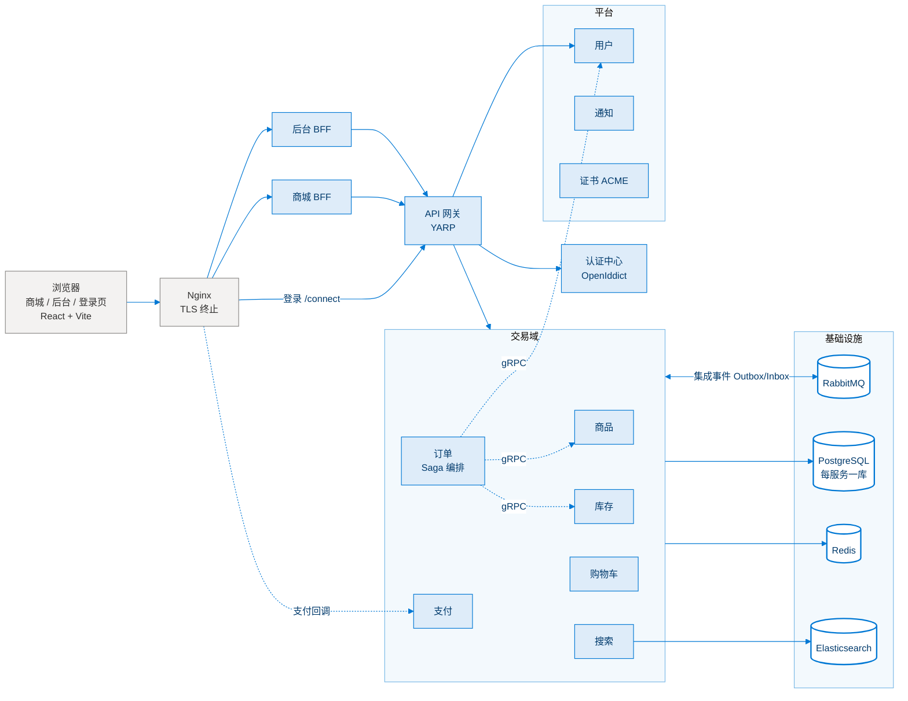
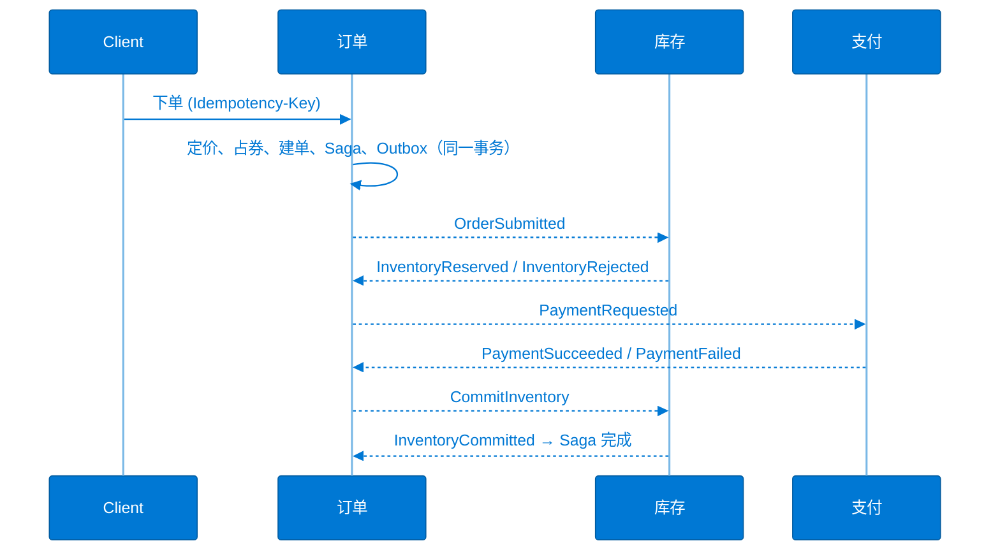

# MicroservicesArchitecture

基于 .NET 10 的微服务电商系统：商品、库存、购物车、订单、支付、搜索、用户、认证、通知、证书共 11 个业务服务，加 API 网关与两个 BFF。
每个服务独立数据库，按 DDD 分层，跨服务交易用 **Saga + Transactional Outbox/Inbox** 实现最终一致性，Docker Compose 部署，OpenTelemetry 全链路可观测。

> 个人项目，重点在分布式系统里容易出错的地方：一致性、幂等、补偿、并发、零停机与安全。

## 架构



- **浏览器只和 BFF 通信**：BFF 走授权码 + PKCE 登录，令牌留在服务端（会话票据存 Redis），浏览器只拿 HttpOnly Cookie。
- **服务间**：同步查询用 gRPC，状态变更用 RabbitMQ 集成事件；服务之间不跨库查询、不共享 EF 实体。
- **服务令牌**：服务调用服务走 OpenIddict client_credentials。

## 核心设计

### 1. 下单交易链路：Saga + Outbox/Inbox



- **Outbox**：业务写入和待发消息在同一个本地事务；发布器用 `FOR UPDATE SKIP LOCKED` + 租约多实例并行领取，指数退避重试，用尽后告警并支持人工重投。开启 RabbitMQ publisher confirms。
- **Inbox**：消费端 `(MessageId, Consumer)` 主键 `INSERT ... ON CONFLICT DO NOTHING`，与业务处理同一事务，实现至少一次投递下的“只处理一次”。
- **重试与死信**：手动 ACK，失败进 TTL 重试队列，超过次数进死信队列，提供查看 / 重放接口。
- **编排式 Saga**：订单服务持有状态机（状态、数据、超时、版本号），后台服务扫描到期超时推进补偿。补偿覆盖库存拒绝、支付失败 / 超时、**超时取消后迟到的支付成功**（重新打开补偿：退款 + 释放库存）；退款使用稳定的 `RefundRequestId` 保证幂等。
- **不依赖消息顺序**：处理器先锁订单行，再按当前状态判断，过期回执只记日志不抛异常。

详见 [docs/core-commerce-refactoring.md](docs/core-commerce-refactoring.md)。

### 2. 幂等与并发

- **下单幂等**：`Idempotency-Key` + Redis 锁（下单键、购物车版本、券用户配额）+ `(UserId, IdempotencyKey)` 唯一索引；请求指纹防止同一个键提交不同内容。
- **防超卖**：库存“预占 → 提交 / 释放”，悲观行锁且多行按固定顺序加锁避免死锁，过期预占后台自动释放；下单前 gRPC 预检库存，挡掉注定失败的请求。
- **金额校验**：支付成功时校验实付金额、币种与下单定价快照哈希。
- **限流**：下单接口按用户令牌桶限流，网关按 IP 限流。

### 3. 搜索：可丢弃、可重建的投影

- 商品变更经 Outbox 发出失效事件，搜索服务通过 gRPC 回读最新快照写入 Elasticsearch（IK 中文分词），`external_gte` 版本号防乱序覆盖。
- 别名切换实现**零停机全量重建**，重建期间双写；ES 不可用时前台降级到 PostgreSQL `pg_trgm` 检索。

详见 [docs/search-service.md](docs/search-service.md)。

### 4. 安全

- OpenIddict 认证中心：授权码 + PKCE、刷新令牌、client_credentials；BFF 模式令牌不落浏览器。流程图见 [docs/BFF_AuthorizationCode_PKCE.png](docs/BFF_AuthorizationCode_PKCE.png)。
- **浏览器 ⇄ BFF 请求体加密**：ECDH P-256 临时密钥协商 + HKDF-SHA256 + AES-256-GCM，服务端无状态，支持密钥轮换与旧客户端平滑过渡。
- HSTS、CSP（frame-ancestors）、nosniff、Referrer-Policy 等安全响应头。
- 证书服务：ACME 自动签发 / 续期（HTTP-01、DNS-01 via DNSPod），按使用方 KEK 加密存储，Nginx 热加载。

### 5. 可观测性

OpenTelemetry → Collector（尾部采样）→ Tempo（链路）/ Prometheus（指标）/ Loki（日志），Grafana 统一查看，链路与日志互相跳转。见 [docker/monitor/README.md](docker/monitor/README.md)。

## 技术栈

| 分类 | 技术 |
|---|---|
| 后端 | .NET 10、ASP.NET Core、EF Core、MediatR（CQRS）、FluentValidation、gRPC、Quartz、Polly |
| 存储 | PostgreSQL（每服务一库）、Redis、Elasticsearch + IK |
| 消息 | RabbitMQ（自研 EventBus、Outbox/Inbox、Saga） |
| 网关 / 认证 | YARP、OpenIddict（OAuth2 / OIDC）、BFF |
| 支付 / 存储 | 支付宝、微信支付、S3 兼容对象存储（腾讯云 COS） |
| 可观测 | OpenTelemetry、Serilog、Prometheus、Grafana、Loki、Tempo |
| 前端 | React 19、TypeScript、Vite、TanStack Query |
| 交付 | Docker Compose、Nginx、Harbor |
| 测试 | MSTest、Moq、TestHost |

## 目录结构

```
src/
├── MSA.ApiGateway/            # YARP 网关
├── BFFs/                      # 商城 BFF、后台 BFF、公共部分（认证、body 加密）
├── MSA.IdentityService/       # 认证中心（OpenIddict）
├── MSA.*Service/              # 业务服务：Catalog、Inventory、Basket、Order、Payment、Search、User、Notification、Certificate
├── MSA.EventBus*/             # 事件总线抽象、RabbitMQ 实现、Outbox
├── MSA.Saga/                  # Saga 状态与超时调度
├── MSA.Redis/                 # 缓存、分布式锁、变更通知
├── MSA.Grpc*/                 # gRPC 契约与客户端基础设施
├── MSA.Observability/         # OpenTelemetry 接入
├── MSA.PaymentCore/           # 支付渠道抽象
└── MSA.Web/                   # 前端：Front（商城）、BM（后台）、Identity（登录页）
tests/                         # 分布式事务、交易域、BFF、证书测试
tools/MSA.CatalogSeeder/       # 批量生成商品与库存测试数据
docker/                        # Compose 编排、监控栈、Elasticsearch、Nginx 配置、构建脚本
docs/                          # 设计文档
```

## 本地运行

**依赖**：.NET SDK 10（见 [global.json](global.json)）、Node.js、PostgreSQL、Redis、RabbitMQ；搜索功能另需 Elasticsearch（[docker/elasticsearch](docker/elasticsearch/README.md)）。

1. 仓库根目录的 `msa.env` 是入库的本地默认值（localhost、镜像默认账号）。自己机器上的地址与口令写进同目录的 `msa.local.env`（不入库，格式相同，只写要改的键）。优先级：环境变量 > `msa.local.env` > `msa.env`。
2. 用 Visual Studio 打开 `MicroservicesArchitecture.slnx`，启动所需服务；首次运行需要建库时，把各服务的 `Database:MigrateOnStartup` 设为 `true`（或设置环境变量 `Database__MigrateOnStartup=true`）。
3. 启动前端：

   ```bash
   src/MSA.Web/dev.bat              # 商城 :5173 / 登录页 :5174 / 后台 :5175
   ```

4. （可选）批量生成商品与库存（默认 50 万商品，先用 `--dry-run` 预览，参数见 `--help`）：

   ```bash
   dotnet run --project tools/MSA.CatalogSeeder -- --dry-run
   ```

## Docker 部署

镜像构建、证书生成、配置分层与入口代理要求见 [docker/README.md](docker/README.md)：

```bash
cd docker
cp .env.example .env
docker compose pull
docker compose up -d
```

## 测试

```bash
dotnet test MicroservicesArchitecture.slnx
```

| 项目 | 覆盖内容 |
|---|---|
| MSA.DistributedTransactionTests | Outbox 原子性、Inbox 幂等、RabbitMQ 投递、Saga 一致性、缓存一致性 |
| MSA.CommerceTests | 商品、库存、购物车、下单、优惠券、秒杀、售后、支付 |
| MSA.BFF.Common.Tests | body 加密中间件 |
| MSA.Certificates.Tests | ACME 客户端、DNSPod 签名、OpenIddict 密钥轮换 |

## License

[MIT](LICENSE.txt)
