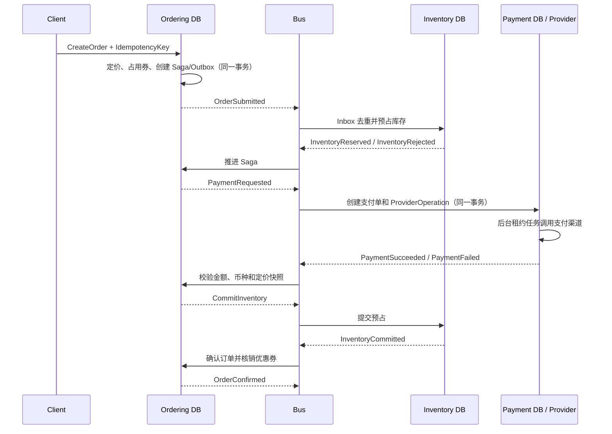

# 核心交易域重构说明

本文描述本次商品、库存、订单、优惠与支付重构的落地设计。系统仍采用独立服务数据库、DDD、CQRS、Transactional Outbox/Inbox 与 Saga，原有交易事件方向不变；旧的 `flash-sale-high-availability.md` 不作为本次设计依据。

## 1. 边界与依赖

四个服务只写自己的 PostgreSQL 数据库，不跨库查询或创建跨库外键：

- Catalog 是商品、类目、促销和优惠券定义的事实源。
- Ordering 是订单、成交价快照、优惠券占用和交易 Saga 的事实源。
- Inventory 是现货、预占、秒杀库存桶和库存流水的事实源。
- Payment 是支付单、支付渠道操作、回调、撤销与退款的事实源。

每个服务保持 `Domain <- Application <- Infrastructure/API` 的依赖方向。写模型通过命令处理器改变聚合；查询使用独立的只读接口和 `AsNoTracking`。跨服务只传递带版本的事实快照或交易事件，不共享 EF 实体。

Catalog 的商品、促销、优惠券变更通过本地 Outbox 发布，Ordering 保存本地投影。下单时只读取 Ordering 数据库，因此商品服务短暂不可用不会把同步 RPC 放进交易路径。

## 2. 数据传输流程

成功路径保持原来的事件顺序，只强化了幂等、快照校验和最终确认条件：

失败和超时仍由 Ordering 中的 `OrderFulfillment` Saga 编排：

- 库存拒绝：取消订单并释放已占优惠券。
- 支付失败或付款截止时间到达：释放库存、释放优惠券，并按支付阶段撤销支付。
- 支付已成功但订单无法继续：使用 Saga 中稳定的 `RefundRequestId` 发起退款，同时释放或补偿库存。
- 只有收到 `InventoryCommitted` 后订单才进入 `Confirmed`，避免“支付成功但库存提交未知”时过早确认。
- 补偿消息可重试；退款、撤销、释放、提交都验证业务标识并返回幂等确认事件。

## 3. Catalog 数据库

| 表 | 责任与关键约束 |
| --- | --- |
| `categories` | 类目草稿、启用、归档；规范化编码唯一；审计时间和乐观版本约束。 |
| `products` | SKU、类目、价格、币种和 Draft/Published/Unpublished/Archived 生命周期；规范化 SKU 唯一；发布修订号及生效时间。 |
| `promotions` | 活动时间窗、优先级、自动/券触发、可叠加/互斥策略、发布修订及定义校验和。 |
| `promotion_rules` | 可扩展规则类型、SchemaVersion、JSONB 参数及执行顺序。 |
| `promotion_benefits` | 可扩展优惠计算器类型、SchemaVersion、JSONB 参数及执行顺序。 |
| `promotion_targets` | All/Sku/Product/Category 等目标与排除目标。 |
| `coupons` | 只保存大写 SHA-256 摘要和掩码，不保存明文券码；有效期、绑定用户、总限额、每人限额和修订号。 |
| `coupon_quota_buckets` | 券总额度的静态分桶定义，发布后不临时拆桶。 |
| `catalog_audit_entries` | 后台动作、实体、操作者、发生时间和变更 JSON 快照。 |

后台接口支持类目创建/改名/启用/归档，商品草稿创建/详情修改/调价/上架/下架/归档，促销创建/替换定义/发布/暂停/恢复/结束，以及优惠券创建/启用/禁用。所有写接口使用 `catalog.write` 授权策略，聚合通过并发版本防止后台人员互相覆盖。

促销扩展点由 `IPromotionRuleEvaluator` 与 `IPromotionBenefitCalculator` 注册表驱动。新增规则或优惠算法时增加新的类型实现和对应 SchemaVersion，不需要修改订单聚合或把任意表达式放进数据库执行。本次内置：最低订单金额、最低商品数量、百分比优惠和固定金额优惠。

## 4. Ordering 数据库

| 表 | 责任与关键约束/索引 |
| --- | --- |
| `orders` | 订单号、用户幂等键、请求指纹、支付方式、定价快照、付款截止时间和终态时间；`(UserId, IdempotencyKey)` 唯一。 |
| `order_lines` | 商品名称/SKU 和列表价、成交单价、行原价、行优惠、行金额的不可变快照；每单 SKU 唯一并校验金额等式。 |
| `order_discounts` | 活动/优惠券来源、金额与 JSONB 规则快照，保留历史解释能力。 |
| `order_status_history` | 每次状态迁移、操作者、原因和时间。 |
| `product_projections` | Catalog 商品的本地读投影。 |
| `flash_sale_campaign_projections` | Inventory 秒杀活动窗口和购买限制投影。 |
| `promotion_projections` | 已发布促销的带版本 JSONB 快照；旧修订不会覆盖新修订。 |
| `coupon_projections` | 券摘要、状态、限额及修订投影；不保存明文。 |
| `coupon_quota_buckets` | Ordering 实际执行额度占用的计数桶。 |
| `order_coupon_redemptions` | Reserved/Consumed/Released 生命周期，关联订单、用户、券和额度桶。 |
| `saga_states` | `OrderFulfillment` 的步骤、重试、超时和补偿数据。 |

防重复下单有三层：

1. 请求先生成规范化语义指纹；同一用户和幂等键、同一载荷返回原订单，不同载荷直接冲突。
2. PostgreSQL 事务级 advisory lock 串行化同一幂等键、同一用户券和同一秒杀买家。
3. 数据库唯一索引做最后防线；秒杀活动使用 `(FlashSaleCampaignId, UserId)` 唯一约束。

优惠券总额度使用条件更新和 `FOR UPDATE SKIP LOCKED` 选择可用桶；热点用户的每人限额由 advisory lock 保护。订单、券额度占用、Saga 和 Outbox 在同一个本地事务提交，确认时核销，取消或补偿时释放。

## 5. Inventory 数据库与防超卖

| 表 | 责任与关键约束/索引 |
| --- | --- |
| `stock_items` | SKU 总现货和已预占数量；保证 `0 <= Reserved <= OnHand`，规范化 SKU 唯一，带并发版本。 |
| `inventory_reservations` | 每个 OrderId 唯一的预占聚合，记录截止时间、提交/释放时间和终态原因。 |
| `inventory_reservation_lines` | 必填的预占明细；每个预占中的 SKU 唯一。 |
| `inventory_request_decisions` | 以 OrderId 为业务键保存请求语义哈希和 Accepted/Rejected 结果，用于稳定重放响应。 |
| `stock_movements` | 只追加库存台账，记录类型、数量、前后余额、业务引用、操作者和幂等键。 |
| `flash_sale_campaigns` | 秒杀窗口、购买限制、库存策略、状态和版本。 |
| `flash_sale_stock_buckets` | 活动分配量、预占量、售出量、释放量；计数和不超过分配量。 |

普通库存按排序后的 SKU 获取事务锁，再在数据库约束下执行预占；任意并发写入都不能使可用量为负。重复的 `OrderSubmitted` 先读取持久化 decision；相同语义重发原结果，不同语义被拒绝。

秒杀根据库存规模采用两种数据库策略：

- `SingleRow`：少量库存使用单行原子条件更新。每次只在“剩余量足够”时增加预占，排队公平且不会超卖。
- `Bucketed`：大量库存静态拆为 2–128 个桶，请求按 OrderId 选择起始桶并用 `SKIP LOCKED` 绕开热点锁。若单桶碎片不足但总量足够，进入带锁的低频整理慢路径，避免有库存却误报售罄。

Redis 仅缓存可用量提示，不参与正确性判断。提交和释放始终回到 PostgreSQL 验证 `OrderId + ReservationId`，更新预占/库存桶并写入不可变流水。

库存后台接口新增带 `OperatorId + IdempotencyKey` 的调整命令和流水查询。相同键、相同语义返回原结果，相同键、不同语义报冲突，便于安全补货、盘点、损益调整和审计。

## 6. Payment 数据库

| 表 | 责任与关键约束/索引 |
| --- | --- |
| `payments` | 每个 OrderId 唯一的支付单；商户单号唯一；金额、币种、定价快照、渠道交易号、累计退款额和状态约束。 |
| `payment_provider_operations` | Create/Cancel/Refund 的持久化任务，保存稳定幂等键、租约、次数、下次重试时间和结果。 |
| `payment_notifications` | 渠道通知号、规范化 payload hash、验签/处理状态；同通知号不同内容记录冲突。 |
| `payment_status_history` | 支付状态迁移、来源、原因和发生时间。 |
| `payment_refunds` | 稳定 `RefundRequestId`、商户退款号、金额、渠道退款号和状态；所有关键业务键唯一。 |
| `payment_cancellation_intents` | 以 OrderId 保存“支付请求到达前的撤销”墓碑，解决跨队列乱序。 |

消息消费者的数据库事务只创建/更新支付实体、ProviderOperation、Inbox 和 Outbox，不在事务中调用外部支付渠道。后台执行器使用短租约和 `SKIP LOCKED` 并行领取任务，在事务外调用渠道，再用租约令牌条件提交结果；超时、指数退避和最大次数均可配置。渠道请求始终复用稳定商户单号/退款号，因此进程崩溃后的重试不会产生新的业务支付或退款。

支付成功事件携带实收金额、币种及定价快照。Ordering 必须与订单不可变快照完全匹配；迟到支付或不匹配支付进入取消/退款补偿，而不是确认订单。

## 7. Outbox、Inbox 与 Saga 一致性

- 每个消费者使用稳定 ConsumerName，并在业务事务内原子插入 Inbox；PostgreSQL 使用 `INSERT ... ON CONFLICT DO NOTHING` 判定重复消息。
- 聚合变化、Saga 状态和要发布的 Outbox 消息在同一个服务数据库事务提交。
- Outbox、支付任务和 Saga 超时领取均使用确定性排序及 `FOR UPDATE SKIP LOCKED`，支持多实例横向扩展。
- 每个 Saga 超时在独立 DI scope/DbContext 中处理；某个 Saga 回滚后不会把脏跟踪实体泄漏到下一项。
- 事件投影比较 SourceRevision；重复或乱序的旧快照不会覆盖新状态。
- RabbitMQ 各服务队列隔离，但统一绑定 `msa.commerce.events` exchange，并各自配置 DLQ。

系统承诺的是至少一次传递下的业务幂等与最终一致性，不依赖“消息只发一次”的假设。

## 8. 迁移与发布顺序

本次新增迁移分别为：

- Catalog：`CommerceBackofficeAndPromotions`
- Inventory：`InventoryDecisionsAndLedger`
- Ordering：`OrderingPricingCouponsAndSagaReliability`
- Payment：`ReliablePaymentProcessing`

主迁移先校验并规范化旧数据，再建立非空列、唯一索引、外键和检查约束；无法安全推断的数据会用清晰异常终止迁移，避免静默损坏。正式发布建议依次完成数据库备份、在影子库执行迁移、部署能同时读取旧/新事件可选字段的消费者、部署生产者，最后观察 Inbox/Outbox/Saga/ProviderOperation 积压与 DLQ。

本轮按要求不新增或执行测试；已通过全解决方案编译和四个 DbContext 的幂等迁移脚本生成校验。
