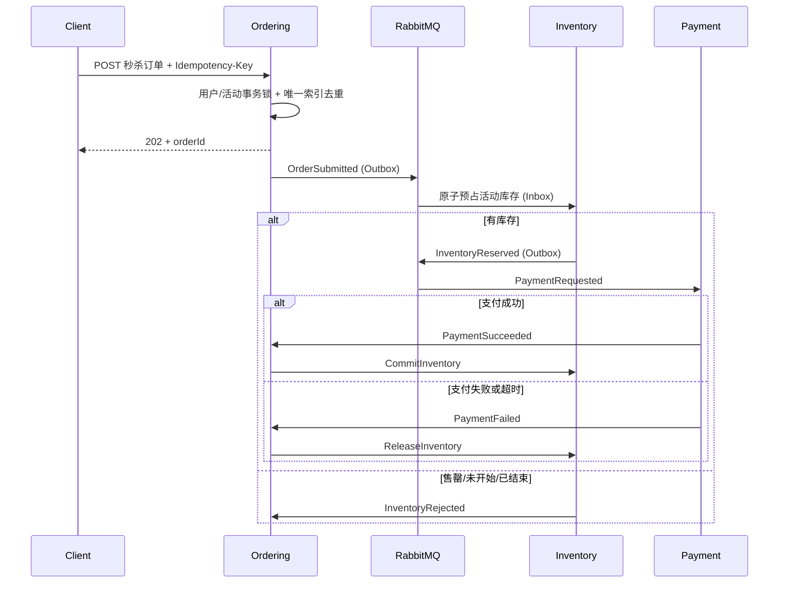

# 秒杀业务高可用设计与运行说明

## 一致性边界

秒杀仍复用现有 Ordering 主导的订单 Saga。Ordering 只负责受理、幂等和订单状态；Inventory 独占库存真相及秒杀配额；Redis 只缓存两秒的可售读模型，缓存不可用时查询自动回源 PostgreSQL。



## 小库存与大库存

| 场景 | 持久化策略 | 并发行为 | 适用范围 |
| --- | --- | --- | --- |
| 少库存 | `SingleRow`，一个 `flash_sale_stock_buckets` 行 | 条件 `UPDATE ... RETURNING` 等待行锁并在锁后重检余量 | 库存较少、竞争可控、严格减少误拒绝 |
| 大库存 | `Bucketed`，默认 32 个库存分片 | 按订单哈希选择起始分片，`FOR UPDATE SKIP LOCKED` 避开热点；短重试后阻塞回退 | 大库存、高并发、需要横向扩展消费者 |

自动策略以 `FlashSale:LargeStockThreshold`（默认 1000）为界。无论使用哪种策略，SQL 的条件更新和数据库检查约束都保证：

```text
ReservedQuantity + SoldQuantity + ReleasedQuantity <= AllocatedQuantity
```

分片数还会受到 `TotalQuantity / PurchaseLimit` 的上限约束，保证每个分片至少能承接一笔达到单用户购买上限的订单。购买数量大于 1 且容易产生尾部碎片时，应减少分片数；库存利用率比吞吐更重要的活动可显式使用 `SingleRow`。

活动创建时会先把 `TotalQuantity` 从普通 `stock_items.Available` 整体预留，普通订单无法再消耗这部分库存。活动关闭时仅归还尚未售出且未被待支付订单持有的数量；晚到的支付成功仍可提交，晚到的失败释放则直接归还普通库存。

## 防重复下单与消息幂等

- API 请求进入 Ordering 本地事务后，按固定顺序获取 `用户 + Idempotency-Key` 与 `用户 + CampaignId` 的 PostgreSQL transaction advisory lock。
- `orders(UserId, IdempotencyKey)` 唯一索引保证请求幂等。
- `orders(FlashSaleCampaignId, UserId)` 部分唯一索引保证一个用户一个活动只生成一张订单，即使更换幂等键也不能重复下单。
- Inventory 的 `inventory_reservations(FlashSaleCampaignId, UserId)` 部分唯一索引提供第二道跨服务防线。
- 每个消费者先写服务本地 Inbox，所有后续事件与业务数据同事务写 Outbox；重复消息不会再次提交或释放库存。
- 订单先超时/取消、库存预占事件后到时，Ordering 会立即发出补偿释放；支付成功与失败冲突时，终态订单不会再反向释放或提交库存。
- 同一幂等键重试返回原 `orderId`。订单受理返回 `202 Accepted`，客户端通过原订单查询接口轮询最终状态。

## 主要表结构

Inventory 数据库新增：

- `flash_sale_campaigns`：SKU、时间窗、购买上限、策略和生命周期。
- `flash_sale_stock_buckets`：活动库存分片及预占/售出/释放计数。
- `inventory_reservations` 新增活动、分片、用户和并发版本列。

Ordering 数据库新增：

- `flash_sale_campaign_projections`：由活动开关事件维护的本地只读投影，避免请求时跨服务同步调用。
- `orders.FlashSaleCampaignId` 及用户活动唯一索引。

对应迁移分别位于两个服务自己的 `Infrastructure/Migrations` 目录，不存在跨服务表连接或共享 DbContext。

## 配置

可通过配置文件或等价环境变量调整：

| 配置 | 默认值 | 说明 |
| --- | ---: | --- |
| `FlashSale:LargeStockThreshold` | 1000 | 自动切换到分片库存的阈值 |
| `FlashSale:DefaultBucketCount` | 32 | 大库存默认分片数 |
| `FlashSale:MaximumBucketCount` | 128 | 允许的最大分片数 |
| `FlashSale:ReservationSkipLockedRetries` | 3 | 无等待分片尝试次数 |
| `FlashSale:AvailabilityCacheDuration` | 2 秒 | Redis 可售读模型 TTL |
| `FlashSale:ExpiryScanInterval` | 5 秒 | 过期活动回收间隔 |
| `FlashSale:ExpiryBatchSize` | 100 | 单批回收活动数 |
| `RabbitMQ:PrefetchCount` | 64（Inventory） | 单消费者预取上限 |

秒杀订单接口还在 Ordering 实例内按用户/IP 使用令牌桶限流；数据库唯一索引与原子扣减是最终正确性保障，所以绕过网关或多实例限流也不会造成重复订单或超卖。

## 上线顺序与基础设施前提

1. 先部署向后兼容的 `MSA.Contracts`（`FlashSaleCampaignId` 为可空字段）。
2. 审核并分别应用 Inventory、Ordering 的新迁移。
3. 部署 Inventory 与 Ordering，再通过 Inventory 管理接口创建活动。
4. RabbitMQ 应使用持久化 quorum queue/镜像拓扑并监控 DLQ；PostgreSQL 应具备主从切换、连接池和备份；Redis 建议 Sentinel/Cluster，但 Redis 故障不会影响库存正确性。
5. 上线前使用生产等价 PostgreSQL 做并发压测，观察数据库锁等待、活动拒绝率、RabbitMQ 堆积、Outbox 延迟、DLQ 和订单最终取消率。

活动应在开售前提前创建并等待 Ordering 的本地投影就绪，以吸收 Outbox/RabbitMQ 的正常传播延迟。当前秒杀订单沿用 Catalog 投影价格；若要配置专属秒杀价，应由 Catalog/Promotion 边界发布价格快照给 Ordering，Inventory 不承载价格真相。

迁移文件只随代码生成，本仓库默认 `Database:MigrateOnStartup=false`，不会在构建或测试时修改数据库。
